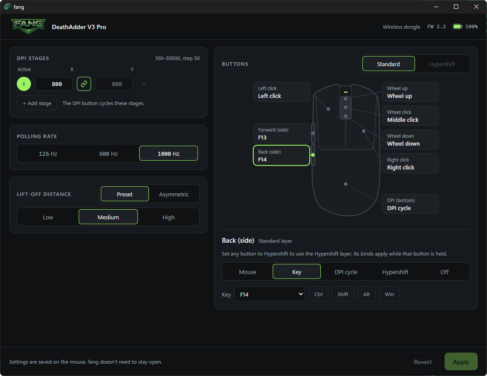

<p align="center">
  
</p>

# fang

**Set up a Razer mouse without Razer Synapse.** fang writes DPI, polling rate, lift-off
distance and button binds straight to the mouse's onboard memory, then exits. Nothing stays
running: no background service, no tray icon, no input hook. The mouse keeps the settings on
any PC.

Comes as a command-line tool (`fang`) and a small desktop app (`fang-gui`). Every write is
read back from the mouse and checked.

## Supported mice

| Mouse | Status |
|---|---|
| Razer DeathAdder V3 Pro | Tested on hardware |
| 74 other Razer mice in [`docs/devices.json`](docs/devices.json) | Not supported yet. Protocol facts pulled from Synapse, never run against the hardware |

## Install

Download from the [latest release](../../releases/latest). To build it yourself, see
[Build from source](#build-from-source).

| OS | Command line | Desktop app | Tested |
|---|---|---|---|
| Windows x64 | `fang-windows-x64.exe` | `fang-gui-windows-x64.exe` | Yes |
| macOS (Apple Silicon and Intel) | `fang-macos-universal` | `fang_<version>_universal.dmg` | Yes |
| Linux x64 | `fang-linux-x64` | `.AppImage` (any distro), `.deb`, `.rpm` | No, reports welcome |

The examples below call the command-line tool `fang`; rename the download to match.

**Windows.** Portable, no installer. The app uses the WebView2 runtime that ships with
Windows. The files aren't code-signed, so SmartScreen warns on first run: **More info > Run
anyway**.

**macOS.** Not signed with an Apple certificate. Open the app the first time with right-click >
**Open**, or run `xattr -cr fang.app`. Make the command-line tool executable with `chmod +x`.

**Linux.** Built on Ubuntu 22.04, so it runs on most current distros. `chmod +x` the command-line
tool or the AppImage. Without a udev rule a normal user can't open the mouse and fang needs
`sudo`. This rule gives the logged-in user access to Razer devices (`1532` is Razer's USB
vendor ID):

```
echo 'KERNEL=="hidraw*", ATTRS{idVendor}=="1532", MODE="0660", TAG+="uaccess"' | sudo tee /etc/udev/rules.d/99-fang.rules
sudo udevadm control --reload-rules && sudo udevadm trigger
```

macOS and Linux builds are untested on real hardware. If you try one, open an issue with what
worked and what didn't.

Check it sees the mouse:

```
fang info
```

```
serial   <your mouse's serial>
firmware <major>.<minor>
```

## Use

```
fang status                                  # read everything stored on the mouse
fang bind back key:F13                       # back side button sends F13
fang bind back mouse:4 hypershift            # same button, Hypershift layer
fang dpi 1000x1100,800,1600,3200,6400 active 1
fang polling 1000
fang liftoff 2                               # preset: 1 low, 2 medium, 3 high
fang liftoff 13 12                           # asymmetric: lift 2-26, land 1-25, land < lift
```

`fang` with no arguments prints the full usage: button names, action syntax and value ranges.
DPI runs 100 to 30000 in steps of 50; a stage is `800` or `1000x1100` for separate X and Y.

## Desktop app

A Tauri app over the same library, about 9 MB on Windows. Open it, change settings,
Apply (writes and reads back), close it.



## Before you start: uninstall Synapse

Keep Razer Synapse uninstalled. When Synapse opens, it rewrites the mouse's onboard memory
with its own profile and your fang settings are gone.

## Limitations

- One mouse model so far (see above).
- fang talks to the first Razer device it finds. Unplug other Razer gear (keyboards,
  headsets) before you write.
- No macro or media-key binds. `status` shows existing ones raw; fang can't write them.
- One onboard profile, the only slot the DeathAdder V3 Pro has.

## Development

### Build from source

Needs [Rust](https://rustup.rs) 1.85 or newer (the crate uses edition 2024).

```
cargo install --path .                       # fang.exe into ~/.cargo/bin
cargo install tauri-cli --version "^2"       # once, for the desktop app
cd src-tauri
cargo tauri build --no-bundle                # -> src-tauri/target/release/fang-gui.exe
```

### Tests

```
cargo test                                   # library tests, no mouse needed
node tools/gui-test.mjs                      # GUI page logic against a fake mouse
cd src-tauri
cargo test -- --include-ignored              # adds a no-change round trip against the real mouse
```

The protocol lives in `src/lib.rs` (`fang::Mouse`). The CLI (`src/main.rs`) and the app
(`src-tauri/`, `web/`) are thin layers over it.

| Doc | What's in it |
|---|---|
| [docs/PROTOCOL.md](docs/PROTOCOL.md) | Report layout and every command, with the source and confidence of each row |
| [docs/SYNAPSE.md](docs/SYNAPSE.md) | Facts pulled from Synapse 4 and what each `devices.json` field means |
| [docs/GUI-BRIEF.md](docs/GUI-BRIEF.md) | Design brief for the desktop app |

### Adding a mouse

1. Capture Synapse talking to the mouse with USBPcap (examples in `captures/`).
2. Decode the 90-byte reports: `uv run tools/razer_reports.py <capture.pcapng> [device_address]`
   (needs Wireshark's `tshark`).
3. Check the commands against that mouse's entry in `docs/devices.json` and record what you
   confirm in `docs/PROTOCOL.md`.

Protocol knowledge comes from reading OpenRazer and Snakecharmer (ideas only, no code), Synapse 4
and our own captures.

## License

[AGPL-3.0-only](LICENSE)
